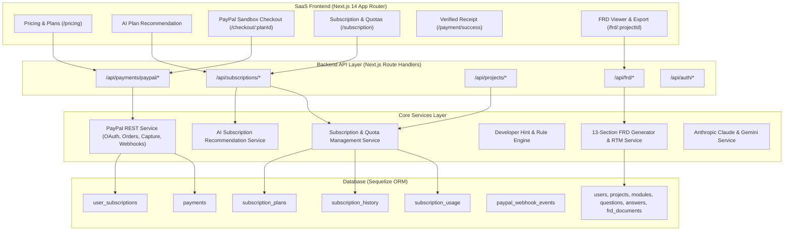

# Speco AI – AI-Powered FRD Generator & SaaS Platform
### Upgraded for PayPal AI Hackathon 2026

An enterprise AI-powered Software Requirements & SaaS ecosystem that automates Functional Requirements Document (FRD) generation, delivers domain-specific Developer Implementation Hints, and integrates a complete **PayPal Developer Sandbox** subscription workflow with **AI-Driven Plan Recommendations**.

---

## 🌟 Hackathon 2026 Core Upgrades

This platform combines conversational AI requirement discovery with a commercial PayPal subscription lifecycle:

1. **PayPal Payment Integration (Developer Sandbox)**
   - PayPal REST API v2 integration with OAuth 2.0 Client Credentials token management.
   - Server-side Order Creation (`POST /v2/checkout/orders`) and Order Capture (`POST /v2/checkout/orders/{id}/capture`).
   - Cryptographic PayPal Webhook verification (`POST /v1/notifications/verify-webhook-signature`) with idempotent event processing.
   - 100% server-side payment verification (frontend prices are never trusted).

2. **AI-Based Subscription Plan Recommendation Engine**
   - Automatically assesses project complexity (Low, Medium, High, Enterprise) based on modules count, requirement volume, domain compliance (HIPAA, PCI-DSS, FinTech), and architectural scale.
   - Uses Anthropic Claude to formulate clear, technical business justifications for the recommended subscription tier.
   - Dynamic plan prices and features retrieved directly from the database (`subscription_plans`).

3. **Complete Subscription Management System**
   - User subscription dashboard with active plan status (`Active`, `Cancelled`, `Expired`), renewal/billing dates, and pricing.
   - Real-time visual quota bars for FRD Generations, Active Project Storage, Document Exports, and AI Plan Recommendations.
   - Seamless plan Upgrade, Downgrade (preserving all existing documents), and Cancellation workflows.
   - Comprehensive Payment History ledger and Subscription Activity Audit trail.

4. **Payment Verification & Automatic Premium Feature Unlocking**
   - Instant automated tier activation upon verified PayPal payment capture.
   - Backend quota enforcement in controllers (`ProjectController.create`, `FRDController.generate`, `FRDController.exportPDF`, `FRDController.exportMarkdown`).
   - Rejects unauthorized or over-quota API requests with structured upgrade prompts.

---

## 🏗️ Architecture & Technology Stack



- **Frontend:** Next.js 14 (App Router), React 18, TypeScript, Tailwind CSS, Lucide React, Radix UI.
- **Backend:** Node.js, Express Adapter, Next.js API Routes, PDFKit, Remark GFM.
- **AI Engine:** Anthropic Claude (`claude-haiku-4-5-20251001`), Google Gemini, and domain-specific validation rule analyzers.
- **Payments:** PayPal Developer Sandbox REST API v2.
- **Database:** Sequelize ORM (SQLite in local development, MySQL production-ready).

---

## 💳 Configured Subscription Tiers

All subscription tiers, prices, and quota limits are stored centrally in the database (`subscription_plans`):

| Plan | Monthly Price | FRD Quota | Project Storage | Exports | Key Features Included |
| :--- | :--- | :--- | :--- | :--- | :--- |
| **Basic Plan** | ₹499 / mo (~$6 USD) | 5 / month | 3 Projects | 5 / mo | Markdown export, standard requirement specs, basic history |
| **Pro Plan** *(Most Popular)* | ₹1,999 / mo (~$24 USD) | 50 / month | 30 Projects | 50 / mo | Executive PDF & Markdown exports, full Developer Hints, Requirement Traceability Matrix (RTM) |
| **Enterprise Plan** | ₹7,999 / mo (~$96 USD) | 500 / month | Unlimited | Unlimited | Custom domain rules, dedicated SLA support, custom webhook integration |

---

## 🚀 Quick Start Guide

### 1. Prerequisites
- Node.js 18.x or 20.x
- npm or pnpm

### 2. Environment Configuration
Create or update `.env` in the root directory:

```env
# Application API URL
NEXT_PUBLIC_API_URL=/api

# Authentication
NEXTAUTH_URL=http://localhost:3000
NEXTAUTH_SECRET=your-nextauth-secret-key
JWT_SECRET=your-jwt-secret-key

# AI Provider Configuration
ANTHROPIC_API_KEY=your-anthropic-api-key
ANTHROPIC_MODEL=claude-haiku-4-5-20251001
GEMINI_API_KEY=your-gemini-api-key

# PayPal Developer Sandbox Configuration
PAYPAL_CLIENT_ID=your-sandbox-client-id
PAYPAL_CLIENT_SECRET=your-sandbox-client-secret
PAYPAL_BASE_URL=https://api-m.sandbox.paypal.com
PAYPAL_WEBHOOK_ID=your-sandbox-webhook-id
PAYPAL_CURRENCY=USD
```

### 3. Database Initialization & Seeding
Run the database synchronization script to create all subscription and payment tables:

```bash
node scripts/sync-subscriptions.js
```

### 4. Start Development Server
```bash
npm run dev
```
Open **[http://localhost:3000](http://localhost:3000)** in your browser.

---

## 🧪 Hackathon Verification & Test Scenarios

Run the automated subscription and PayPal API test suite:

```bash
node scripts/test-subscription-apis.js
```

### Verified User Journeys:
1. **Explore Plans:** Visit `/pricing` to view responsive plan cards with dynamic pricing retrieved from the database.
2. **AI Plan Recommendation:** Click *"AI Recommend Plan for My Project"* on the pricing page. Claude analyzes project architecture (modules, scale, volume, domain) and outputs a justified recommendation.
3. **PayPal Sandbox Checkout:** Click *"Upgrade to Pro with PayPal"* to navigate to `/checkout/pro`.
4. **Order Creation & Capture:** Initiate PayPal Sandbox payment. The backend securely creates and captures the order via PayPal REST API.
5. **Instant Premium Unlock:** Backend records the payment, logs the subscription audit history, updates quotas, and redirects to `/payment/success`.
6. **Subscription Dashboard:** Visit `/subscription` to view active status, real-time quota progress bars, PayPal payment history ledger, and downgrade/cancellation controls.
7. **Backend Quota Enforcement:** Over-quota requests to create projects or generate FRDs return structured HTTP 403 responses with upgrade prompts.

---

## 📄 License
This project is licensed under the MIT License - open for sharing and collaboration for the PayPal AI Hackathon 2026.
